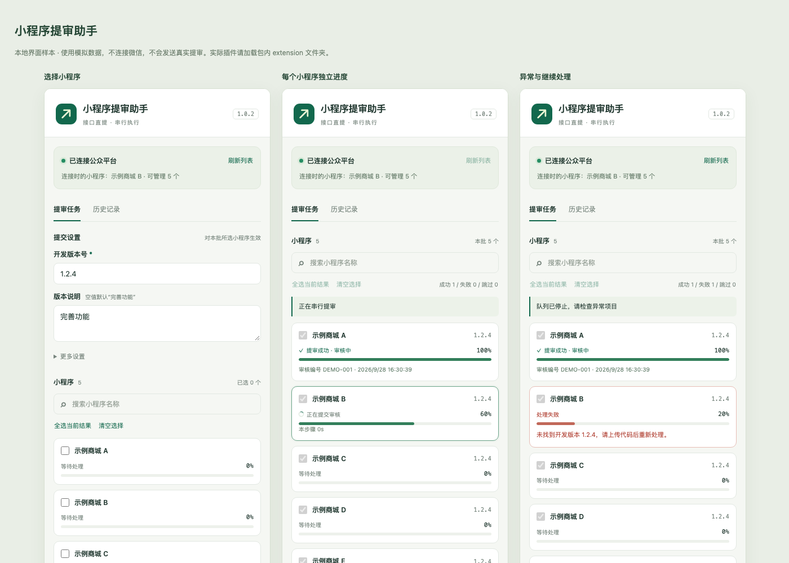
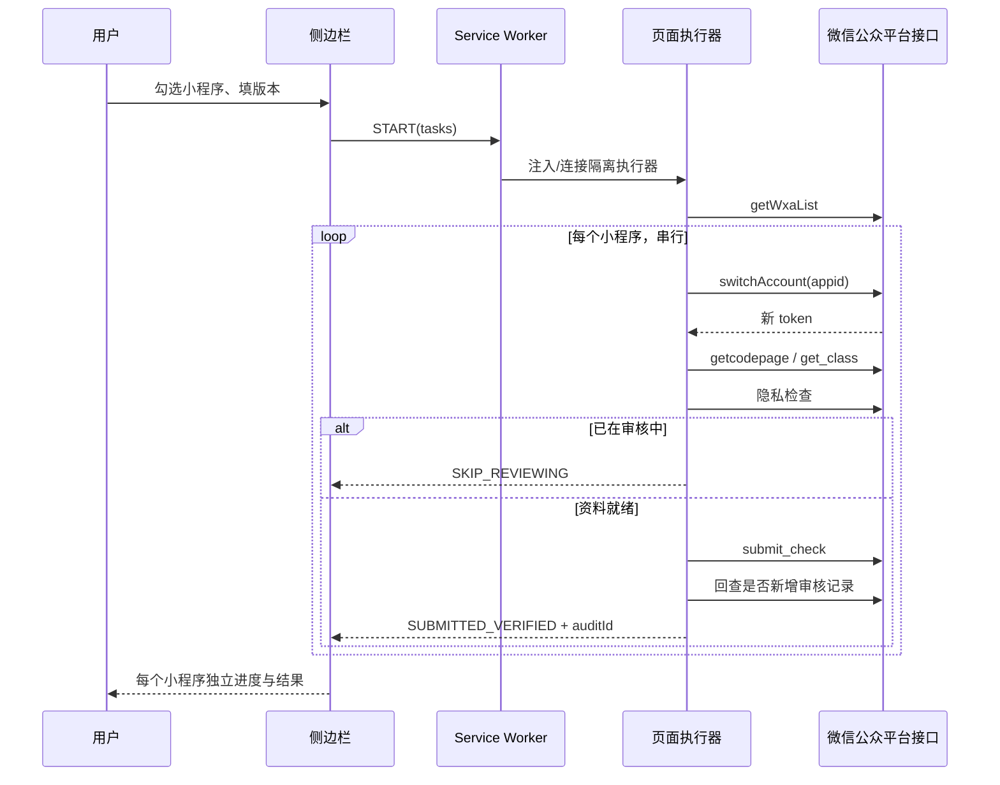

# 小程序提审助手

[](https://developer.chrome.com/docs/extensions/develop/migrate/what-is-mv3)
[](https://github.com/ink-sss/wechat-miniapp-audit-helper/actions)
[](LICENSE)

一个 Chrome Manifest V3 侧边栏扩展，用微信公众平台网页端接口批量提交小程序审核。

它不是 RPA，不模拟点击页面按钮。扩展在已登录的公众平台标签页里串行调用网页端接口：读取小程序列表、切换账号、读取开发版本与审核资料、提交审核、回查审核记录。

> **使用前请阅读**
>
> - 非腾讯官方项目，与微信 / 腾讯无关联。
> - 使用的是公众平台网页端接口，不是开放平台第三方授权 API；接口可能随时变化。
> - “开始提审”会真实提交审核，不会发布上线，也不会撤回或删除版本。
> - 仅用于你拥有或获得授权管理的小程序账号。请先在测试账号或单个小程序上验证。
> - 作者不对账号风控、接口变更、审核结果或误操作承担责任。详见 [LICENSE](LICENSE)。

[English overview](README.en.md)

## 功能

- 自动读取当前登录账号下的小程序列表，不需要手工维护 AppID 清单。
- 支持搜索、全选当前搜索结果、清空选择。
- 串行切换小程序并更新内存中的 token，避免并发切号导致串号。
- 自动匹配指定版本的开发包；同版本有多个开发者时提示选择。
- 已在审核中的小程序自动跳过，不撤回、不删除。
- 同版本已上线也允许再次提审，最终以微信接口结果为准。
- 每个小程序独立显示步骤进度，不伪造整批进度。
- 提交后回查是否新增审核记录，并显示审核编号和提交时间。
- 提交响应不确定时只回查、不自动重发。
- 支持“本项完成后暂停”、继续未处理项、重新检查明确失败项。
- 最近 10 个批次保存在本机，可导出 JSON。
- 不读取 Cookie，不保存或导出 token，无遥测、无远程脚本、无第三方上传。

## 界面



## 安装

### 从源码加载

1. 下载或克隆本仓库。
2. 打开 `chrome://extensions`。
3. 开启右上角“开发者模式”。
4. 点击“加载已解压的扩展程序”。
5. 选择仓库里的 **`extension`** 文件夹（这一层直接包含 `manifest.json`）。
6. 在工具栏扩展菜单中固定“小程序提审助手”。

要求 Chrome 116 及以上。不需要构建，不需要安装依赖。

### 从 Release 安装

下载 [最新 Release](https://github.com/ink-sss/wechat-miniapp-audit-helper/releases/latest) 里的 `wechat-miniapp-audit-helper-v1.0.2.zip`，解压后选择其中的 `extension` 文件夹加载。

## 使用

1. 在 Chrome 中登录 [微信公众平台](https://mp.weixin.qq.com/)，进入小程序后台。地址栏中应带有 `token=` 参数。
2. 点击工具栏中的“小程序提审助手”图标，打开侧边栏。
3. 插件会自动连接当前标签页并读取小程序列表。
4. 勾选要提审的小程序，填写开发版本号，例如 `1.2.4`。
5. 建议先点 **“仅预检查”**。它只切号并读取资料，不发送提审或隐私更新请求。
6. 确认无误后点 **“开始提审”**。每个小程序会独立推进到 20% → 40% → 60% → 80% → 100%。

### 版本说明

留空时使用“完善功能”。填写后会去除首尾空白；超过 200 字会在提交前停止。

### 订单路径

在“更多设置”中选择：

- 沿用各自已有路径，没有则留空；
- 全部留空；
- 统一指定路径。

订单路径不能包含 `?` 或 `#`。

### 暂停与恢复

- “本项完成后暂停”：当前小程序提交和回查完成后暂停，后面的项目保持 0%。
- “继续未处理项”：创建一个只包含等待项目的新批次，仍会重新检查版本和审核状态。
- “重新检查失败项”：只处理明确失败的项目；结果不确定的项目需要先到微信后台核验。
- 收起侧边栏不会终止队列；刷新或关闭目标标签页会中断执行。
- 中断时已经发送请求的项目会标记为“待人工核验”，不会自动重发。

## 工作方式



更完整的模块划分和安全不变量见 [docs/ARCHITECTURE.md](docs/ARCHITECTURE.md)，接口与字段说明见 [docs/API-NOTES.md](docs/API-NOTES.md)。

## 安全设计

- **只申请必要权限**：`sidePanel`、`storage`、`scripting`，以及 `https://mp.weixin.qq.com/*` 站点权限。
- **不申请 Cookie 权限**：请求由页面自身登录态携带，扩展不读取、不保存 Cookie。
- **token 只在内存**：从当前页面 URL 读取，切号后更新；不写入 `chrome.storage`，不导出。
- **串行队列**：使用 `navigator.locks` 和页面内 `busy` 双重互斥，避免多个标签页同时提审。
- **提交前二次核对**：提交前重新读取账号身份、开发版本和审核记录，发现变化就停止。
- **结果不确定不重发**：网络超时或响应异常时只回查审核记录；无法确认时标记“待人工核验”。
- **只读回查**：重连后只查询当前小程序，不切换账号、不自动续提。
- **消息来源校验**：开始提审的消息只接受扩展页面，网页或 content script 不能直接启动任务。

## 适用范围与限制

当前实现覆盖的是抓包验证过的**普通提审**流程：

- 无测试账号；
- 隐私指引已完善；
- 无额外扫码或特殊声明；
- 非仅企业微信运行；
- 不需要新增截图或视频；
- 不自动撤回、删除或发布版本。

遇到测试账号、补充材料、额外扫码等流程时，插件会停止并显示原因，不会借用其他小程序的资料，也不会猜测参数。

其他限制：

- 微信可能调整接口路径、字段或风控策略；接口变化后需要更新 `extension/engine.js`。
- 不支持开放平台第三方授权 API（`/wxa/submit_audit`）。
- 不保证审核通过，只负责提交并确认进入审核队列。
- 浏览器重启后不会自动恢复提交，历史中的运行状态会标记为中断。

## 开发

```bash
npm install
npm test          # 100 项 Node 测试
npm run test:ui   # jsdom 侧边栏交互测试
```

测试使用脱敏样本和模拟 Chrome API，不发送真实请求。

### 项目结构

```text
extension/          Chrome 扩展源码（加载这一层）
  manifest.json
  background.js     Service Worker：连接、队列锁、状态持久化
  content.js        页面执行器：任务调度与进度上报
  engine.js         接口引擎：切号、读版本、提交、回查
  panel.html/js/css 侧边栏 UI
  shared.js         共享常量、校验、任务状态
tests/              Node / jsdom 测试
docs/               架构与接口说明
```

修改扩展后，在 `chrome://extensions` 点击“重新加载”，再重新打开侧边栏。公众平台页面不需要刷新；新版会自动检查并替换页面里的旧执行器。

## 常见问题

**提示“当前 URL 没有 token”**

请先登录公众平台并进入小程序后台，确认地址栏有 `token=` 参数。插件不会读取登录页或普通官网页面。

**提示“旧执行器仍在结束请求”**

旧任务还在收尾。侧边栏会自动等待并重连；不要同时用旧脚本或其他标签页操作同一登录会话。

**提示“待人工核验”**

请求已经发出，但响应丢失或回查未确认。请到微信后台查看该小程序的审核记录，不要直接重复提交。

**提示“此版本涉及测试账号 / 额外声明 / 扫码”**

当前版本不支持这些特殊流程，需要在网页手动完成。

## 贡献

见 [CONTRIBUTING.md](CONTRIBUTING.md)。提交测试样本前请脱敏：不要包含真实 AppID、公司名、审核编号、token、Cookie、二维码 scene 或账号昵称。

## 安全

见 [SECURITY.md](SECURITY.md)。请不要在 Issue 中粘贴 token、Cookie、AppSecret 或完整后台响应。

## License

[MIT](LICENSE)
